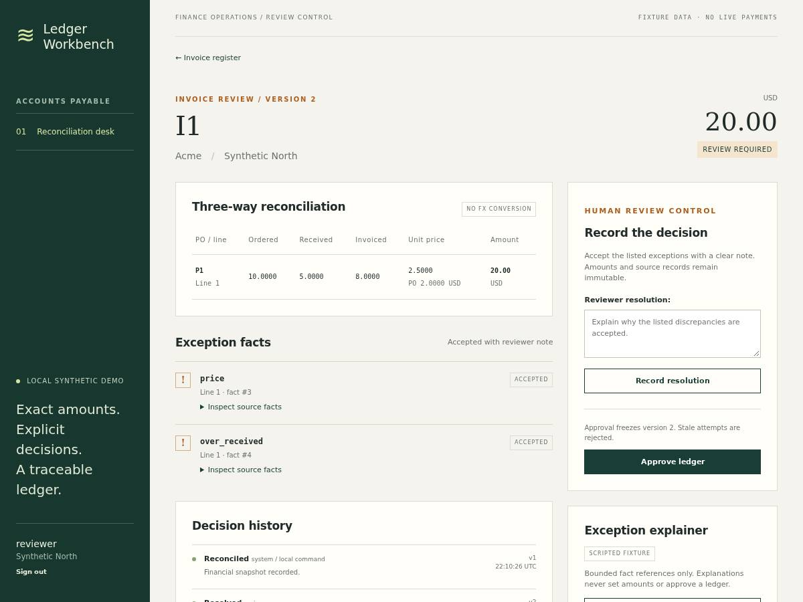

# Invoice Reconciliation Workbench

A local accounts-payable review desk built with **Python 3.12, Django 5.2 and PostgreSQL 16**. A reviewer imports purchase orders, receipts and invoices, inspects exact-money discrepancies, records a versioned decision and downloads a frozen approved ledger.

The engineering problem is preserving a review decision while source records, browser tabs and background work can change concurrently. This portfolio project demonstrates atomic CSV staging, Decimal arithmetic, explicit matching, PostgreSQL locking, tenant boundaries and fenced background jobs in a server-rendered application.



*Real Chromium screenshot of newly synthetic records. The exception explainer uses recorded fixtures; it cannot set amounts or approve invoices.*

## Try the workflow

1. Import the [synthetic CSV fixtures](fixtures/demo): purchase orders, receipts, then invoices. The demo command seeds these automatically.
2. Inspect INV-204: partial delivery, a price difference and a duplicate financial fingerprint. INV-205 exposes a currency mismatch; INV-207 has no matching purchase order.
3. Open an invoice in two tabs. Record an acceptance note in one, then attempt approval in the stale tab. Reload the current review before approving.
4. Download the approved ledger. Later source imports cannot alter this historical snapshot. INV-203 starts with a clean approved GBP ledger.
5. Queue a fixture explanation and process it with the worker. Activity retains exact exception fact IDs and explicit unknown provider usage.

## Local setup

Prerequisites: Python **3.12**, [uv](https://docs.astral.sh/uv/), a running **PostgreSQL 16** instance and PostgreSQL client commands. Run the following from the repository root. Use a dedicated local database and a local role with database-creation permission for pytest.

If that role does not exist, a PostgreSQL administrator can create it with `createuser --createdb --pwprompt invoice_demo` using the administrator connection settings. Choose a password for this local role. Then configure the application shell explicitly (adapt host/port/user to your own local PostgreSQL):

```sh
export PGHOST=127.0.0.1
export PGPORT=5432
export PGDATABASE=invoice_recon
export PGUSER=invoice_demo
export PGPASSWORD=YOUR_LOCAL_DATABASE_PASSWORD
export DEMO_MODE=1
export SECRET_KEY=local-synthetic-demo-only-change-for-any-other-use

createdb "$PGDATABASE"
uv sync --frozen
uv run python manage.py migrate
uv run python manage.py seed_demo
uv run python manage.py worker --once
uv run python manage.py runserver 127.0.0.1:8102 --noreload
```

Replace `YOUR_LOCAL_DATABASE_PASSWORD` before running. For a local role using peer or trust authentication, omit `PGPASSWORD`. If the database already exists, skip `createdb`. The explicit environment avoids the development defaults in settings. Environment files are not loaded automatically; if using [.env.example](.env.example), edit every database value for your machine and load it with `set -a; . ./.env; set +a`.

Open **http://127.0.0.1:8102**. Synthetic demo accounts:

| Account | Password | Organization |
|---|---|---|
| reviewer | local-demo-2026 | Northstar Workshop |
| other-reviewer | local-demo-2026 | Southbank Studio |

These are public, deliberately synthetic local-demo credentials. Seeding requires `DEMO_MODE=1`. The second account has a separate persisted tenant. After configuration, `uv run python manage.py demo` combines migration, idempotent seeding, one worker pass and the loopback development server; `demo --check` performs setup without starting the server.

To process explanations queued from the UI, open another shell with the same environment and run:

```sh
uv run python manage.py worker --once
# Or poll until Ctrl-C:
uv run python manage.py worker
```

[compose.yaml](compose.yaml) is an **optional, unexecuted** PostgreSQL setup example. It publishes only local port 15532; if you use it, select `PGPORT=15532` and its documented local credentials instead of the example above. The verified environment used a private PostgreSQL instance, not Compose.

## Engineering choices

- **Exact financial facts:** finite, nonnegative Decimal inputs; extended amounts round once with ROUND_HALF_UP. Totals remain separate by currency.
- **Atomic import:** validate the entire bounded file before publication; canonical retries are idempotent and conflicting keys never replace existing records.
- **Versioned review:** an organization source revision and consistent organization → invoice lock order reject stale acceptance and approval. Approval copies a frozen financial snapshot.
- **Server-owned authority:** Django sessions and CSRF, membership-based organization scoping on pages/actions/downloads/jobs, and spreadsheet-safe exported text.
- **Durable fixture jobs:** random claim tokens, cancellation, lease/deadline checks after lock acquisition, bounded facts and exact citations. No live provider path or financial mutation authority.
- **Small frontend:** authored HTML/CSS and locally licensed HTMX; ordinary forms also work without JavaScript.

Read the [architecture](docs/architecture.md), [tradeoffs](docs/tradeoffs.md) and [verification notes](docs/verification.md). The organization lock deliberately favors simple correctness over unmeasured high-volume throughput.

## Import and approval limits

UTF-8 CSV only, exact ordered headers, **256 KiB / 500 data rows** maximum. Identifiers are case-sensitive and preserved exactly; matching uses organization/vendor/PO/line, without fuzzy matching.

| Type | Exact header |
|---|---|
| po | vendor,po,line,currency,quantity,unit_price |
| receipt | vendor,po,line,receipt,quantity |
| invoice | vendor,invoice,po,line,currency,quantity,unit_price |

Only USD, EUR and GBP are supported, with no FX conversion or combined mixed-currency numeric total. Quantities and unit prices allow at most four decimal places and 1,000,000,000. For example, `3 × 0.335 = 1.01`; totals sum rounded line amounts.

Existing invoice numbers, PO lines and receipt keys cannot be overwritten. All invoices count conservatively toward cumulative PO/receipt quantities, including unapproved duplicates. New source batches invalidate unapproved acceptance, even for unrelated invoices. A single required note accepts every listed exception in that version; this is acceptance of a discrepancy, not correction of source records or authorization to send money.

This local demo has no payment execution, OCR, tax, credit-note workflow, arbitrary vendor formats or production hosting. Audit history is application-level, not tamper-proof against a database administrator. No customer use, business impact, production scale or live-model quality is claimed.

## Verification

With the same local environment and a PostgreSQL role permitted to create a test database:

```sh
make verify
uv run playwright install chromium
# Install the browser system libraries appropriate to your OS if needed.
BROWSER_EVIDENCE_DIR="$PWD/.browser-evidence" make browser
```

`make verify` checks the dependency lock, frozen sync, Django configuration, migration drift, Ruff lint/format, mypy, real PostgreSQL tests and fixture evaluations. The browser gate is separate and requires port **8102** to be free: stop the demo server first. Browser artifacts default to a writable temporary directory; `BROWSER_EVIDENCE_DIR` retains screenshots and the downloaded ledger at a chosen destination. `.browser-evidence` is ignored.

At tested code commit **`7cc51c2d0cff74abbd091df3efbc1aa36fc14a6a`**, recorded gates passed **66 non-browser tests, 1 Chromium journey and 8 scripted fixture evaluations**. PostgreSQL contention cases observe actual lock waits for competing review/import/approval operations. The browser covers login, three CSV imports, discrepancies, acceptance, stale approval, fresh approval, download and reload. These are functional checks, not measured live-model accuracy, latency or spend. The screenshot above comes from that verification run; private machine-specific logs are not required to run the project.

## Authorship and license

Created with AI coding assistance. [Contribution notes](docs/contributions.md) describe human direction and AI-authored implementation; [data provenance](docs/data-provenance.md) documents newly synthetic fixtures and third-party assets. No employer code, private data or customer records are included.

Original project code and documentation are available under the [MIT License](LICENSE), copyright 2026 Derek Derui Wang. Vendored HTMX retains its [Zero-Clause BSD license](static/vendor/HTMX-LICENSE); upstream dependencies retain their own licenses. See [CONTRIBUTING.md](CONTRIBUTING.md) for local contribution guidance.
